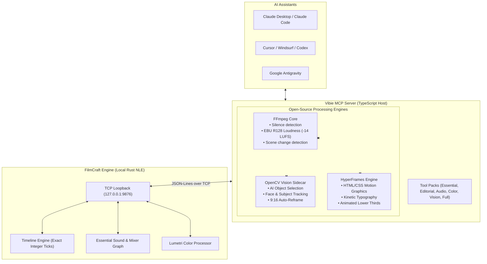

<div align="center">

# 🎬 Vibie MCP
### The AI "Vibe Video Editor" MCP for FilmCraft & Open-Source Post-Production

[](LICENSE)
[](https://nodejs.org/)
[](https://www.typescriptlang.org/)
[](https://modelcontextprotocol.io/)
[](https://github.com/storytold/filmcraft)

**Vibie** is a next-generation Model Context Protocol (MCP) server that transforms **[FilmCraft](https://github.com/storytold/filmcraft)** (the open-source Premiere Pro reimplementation in pure Rust) into an autonomous, AI-driven **vibe video editor**.

Powered by **TypeScript**, **FFmpeg**, **OpenCV**, and **HyperFrames (HeyGen)**.

</div>

---

## 🌟 Why Vibie?

Traditional video editing involves hours of repetitive friction: cutting dead air, syncing audio, hunting down clips, reframing 16:9 shots to 9:16 vertical reels, and building lower thirds. 

**Vibie bridges human taste with agentic execution:**
- 🏎️ **Fast Assembly**: Remove silences and generate rough cuts in seconds with FFmpeg.
- 🎯 **AI Object Masking**: Select subjects and generate organic polygon contours via OpenCV even before native AI masks land in FilmCraft.
- 📱 **Smart 9:16 Auto-Reframe**: Smoothly pan-and-scan horizontal footage for TikTok and YouTube Shorts by tracking faces.
- 🎨 **HyperFrames Graphics**: Render dynamic, animated lower thirds, chapter cards, and subtitles directly from HTML/CSS to timeline tracks `V2` and `V3`.
- 🛡️ **Safe & Reviewable**: Every mutation generates structured audit receipts and undo checkpoints so you never lose work.

---

## 🏗️ Architecture



---

## 🧰 Available Tools & Domains

| Domain | Tool Name | Description |
| :--- | :--- | :--- |
| **Inspection** | `filmcraft_inspect_timeline` | Deep scan of active sequence, tracks, clips, and playhead. |
| | `filmcraft_capture_frame` | Grab the Program Monitor frame for visual AI inspection. |
| | `filmcraft_add_marker` | Add timestamped editorial feedback notes and colored markers. |
| **Timeline** | `filmcraft_place_clip` | 3-point insert/overwrite media onto tracks (`V1`, `V2`, `A1`, `A2`). |
| | `filmcraft_razor_cut` | Split clips across tracks at exact second or playhead timecode. |
| | `filmcraft_ripple_delete` | Remove clips or empty gaps and auto-close spacing. |
| | `filmcraft_slip_slide` | Micro-adjust clip in/out points while preserving timeline position. |
| | `filmcraft_silence_remover` | Auto-detect dead air with FFmpeg and batch ripple-delete. |
| **Audio** | `filmcraft_audio_gain` | Normalize clip peaks or set decibel levels. |
| | `filmcraft_essential_sound_ducking` | Auto-duck background music beds beneath dialogue. |
| | `filmcraft_measure_loudness` | Check broadcast EBU R128 loudness and gain offsets to -14 LUFS. |
| **Color** | `filmcraft_lumetri_grade` | Fine-tune exposure, contrast, temperature, highlights, and shadows. |
| | `filmcraft_lumetri_match` | Match color grading between two clips using reference timecodes. |
| **Vision** | `filmcraft_object_select_mask` | Isolate people or subjects with organic polygon mask contours. |
| | `filmcraft_auto_reframe_vertical` | Pan-and-scan horizontal video to vertical 9:16 Shorts with face tracking. |
| **Graphics** | `filmcraft_generate_lower_third` | Render sleek animated speaker overlays with HyperFrames. |
| | `filmcraft_generate_title_card` | Render kinetic typography title cards. |
| **Export** | `filmcraft_export_sequence` | Trigger hardware NVENC/VideoToolbox or software render exports. |
| | `filmcraft_export_markers` | Export sequence review notes to CSV. |

---

## ⚡ Quickstart

### 1. Requirements
* **Node.js** v20+
* **FilmCraft** installed and running with `--control 9876`:
  ```bash
  filmcraft --control 9876
  ```

### 2. Installation
```bash
git clone https://github.com/<your-username>/vibie-mcp.git
cd vibie-mcp
npm install
npm run build
```

### 3. Add to Claude Desktop (`claude_desktop_config.json`)

```json
{
  "mcpServers": {
    "vibie": {
      "command": "node",
      "args": ["d:/MCP Vibie/dist/index.js"],
      "env": {
        "FILMCRAFT_HOST": "127.0.0.1",
        "FILMCRAFT_PORT": "9876",
        "VIBIE_PACK": "full"
      }
    }
  }
}
```

### 4. Add to Cursor (`.cursor/mcp.json`)

```json
{
  "mcpServers": {
    "vibie": {
      "command": "node",
      "args": ["d:/MCP Vibie/dist/index.js"]
    }
  }
}
```

---

## 🎯 Pre-Built Workflow Prompts

Vibie includes guided prompts out of the box:
* **`vibie_rough_cut`**: Ingest footage, detect pauses with FFmpeg, ripple-delete silences, and normalize dialogue to -14 LUFS.
* **`vibie_podcast_shorts_generator`**: Convert a podcast moment into a 9:16 vertical short, track the speaker, duck background music, and add a lower third.
* **`vibie_ai_object_mask`**: Inspect the frame and segment subjects using OpenCV contours.

---

## 🤝 Contributing & Community

Vibie is 100% open-source under the **MIT License**. Contributions, issues, and feature requests are welcome!

Made with ❤️ for the **FilmCraft** and **ArtCraft** creative community.
